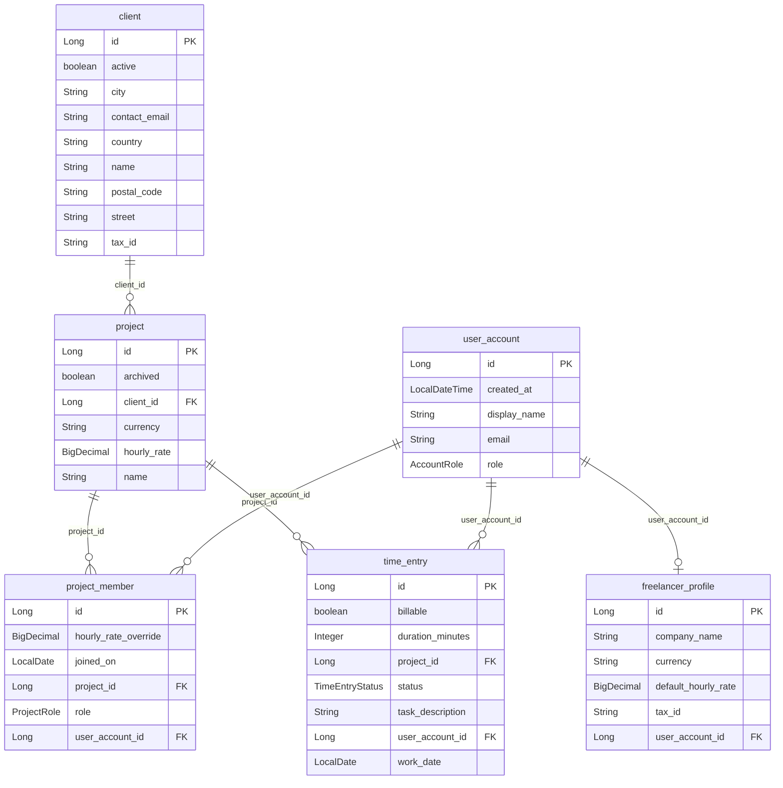

# Schemat bazy danych

Plik generują reguły projektu (panel Maven → Lifecycle → verify). Nie edytujcie go ręcznie.

Tabele: 6 · kolumny: 40 · relacje: 5 × @ManyToOne, 1 × @OneToMany, 1 × @OneToOne, 0 × @ManyToMany

| Tabela | Encja | Kolumny | Klucze obce |
|---|---|---|---|
| client | Client | 9 | — |
| freelancer_profile | FreelancerProfile | 6 | user_account_id |
| project | Project | 6 | client_id |
| project_member | ProjectMember | 6 | project_id, user_account_id |
| time_entry | TimeEntry | 8 | project_id, user_account_id |
| user_account | UserAccount | 5 | — |

